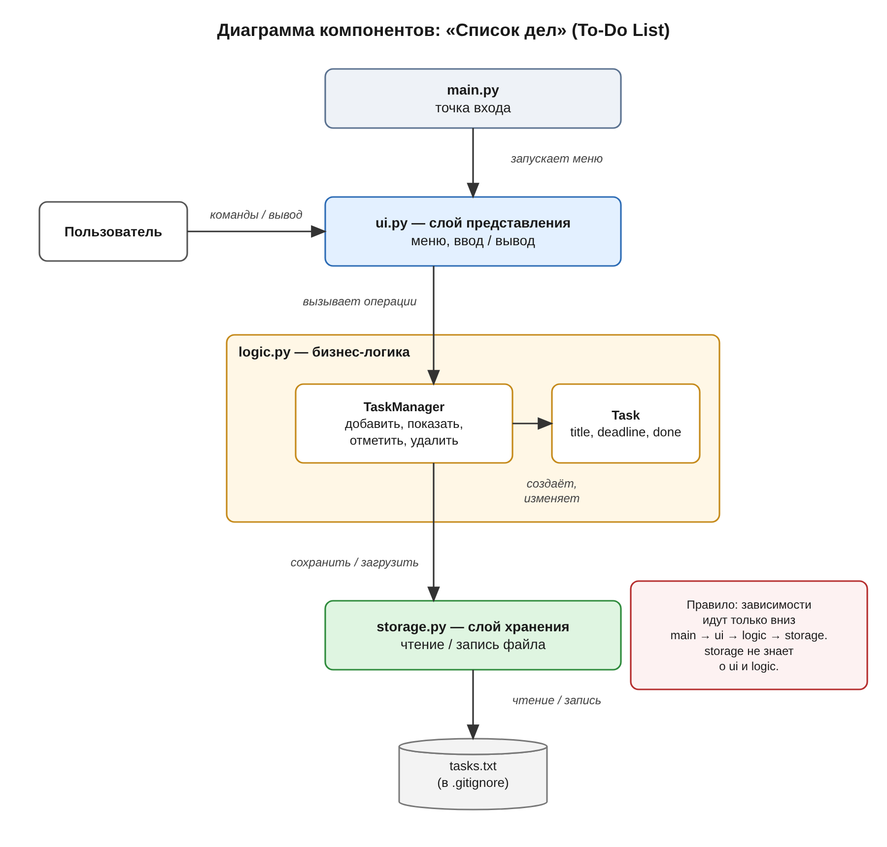

# Архитектура: Список дел (To-Do List)

## Функциональные требования

1. Добавить дело (название, срок выполнения).
2. Вывести список всех дел с отметкой статуса (выполнено / не выполнено).
3. Отметить дело выполненным.
4. Удалить дело.
5. Сохранять список дел между запусками программы.

## Компоненты

- **main.py** — точка входа: запускает приложение и передаёт управление интерфейсу.
- **ui.py** — слой представления: показывает меню, принимает ввод пользователя и выводит список дел на экран. Сам ничего не вычисляет и не хранит, а обращается к logic.py.
- **logic.py** — бизнес-логика, состоит из двух частей:
  - **Task** — модель одного дела: название, срок, статус выполнения;
  - **TaskManager** — управляет списком дел: добавление, отметка выполнения, удаление, получение списка.
- **storage.py** — слой хранения: сохраняет список дел в файл tasks.txt и загружает его при запуске, чтобы дела не терялись между запусками.
- **tasks.txt** — файл с данными; его создаёт сама программа, поэтому он не хранится в репозитории (указан в .gitignore).

## Связи

main.py запускает ui.py.

ui.py обращается к logic.py (TaskManager).

TaskManager создаёт и изменяет объекты Task.

TaskManager читает и сохраняет данные через storage.py.

storage.py читает и записывает файл tasks.txt.

Обратные вызовы запрещены: storage не знает о ui и logic, logic не знает о ui.
Зависимость идёт только вниз: main → ui → logic → storage.

## Диаграмма компонентов

Исходник диаграммы: `architecture.drawio` (draw.io) и `architecture.puml` (PlantUML).
